<picture>
  <source media="(prefers-color-scheme: dark)" srcset="./assets/stack-dark.svg" />
  <source media="(prefers-color-scheme: light)" srcset="./assets/stack-light.svg" />
  
</picture>

<a href="https://www.curseforge.com/members/dreamforsh/projects">
  <picture>
    <source media="(prefers-color-scheme: dark)" srcset="./assets/curseforge-dark.svg" />
    <source media="(prefers-color-scheme: light)" srcset="./assets/curseforge-light.svg" />
    
  </picture>
</a>

